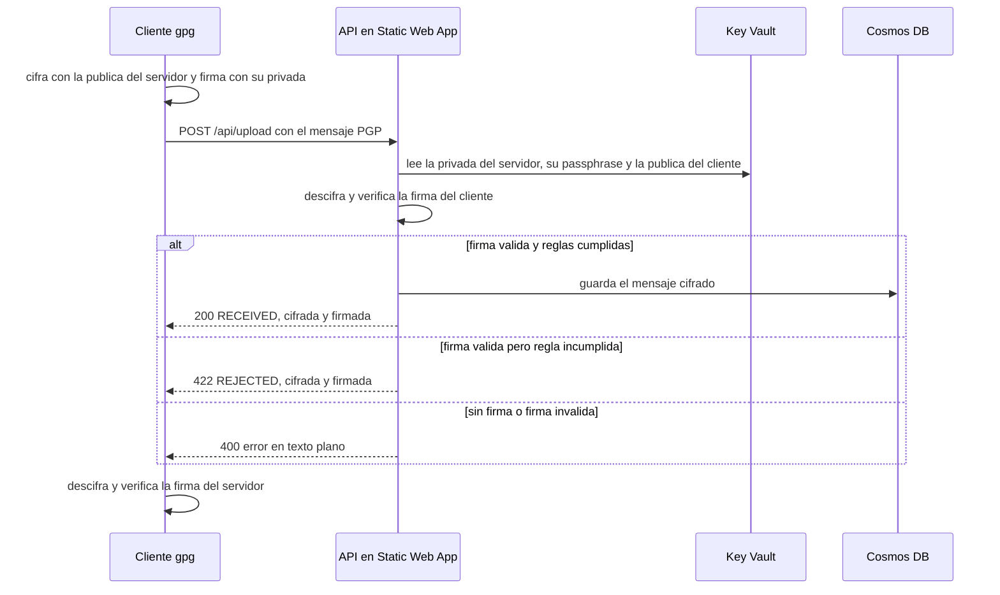

# Secure File Exchange

[English](README.md)

Intercambio de ficheros cifrados y firmados con PGP sobre Azure, montado para que no genere coste. Está inspirado en el intercambio de ficheros de los entornos bancarios (SFTP más PGP): el cliente deja un fichero cifrado para el servidor y firmado por él, y el servidor responde con una confirmación firmada por él y cifrada para el cliente.

Es un proyecto de aprendizaje con claves de prueba, no un sistema listo para datos reales. Las diferencias con un entorno real están en el apartado de limitaciones.

## Qué hace

El cliente cifra el fichero con la clave pública del servidor, lo firma con su clave privada y lo sube por HTTPS. El servidor puede responder de tres maneras:

- **Fichero aceptado (200).** La firma es válida y cumple las reglas. Se guarda cifrado y se devuelve una confirmación `RECEIVED` con el hash, el tamaño y un identificador de recibo.
- **Fichero rechazado (422).** La firma es válida pero el servidor no lo acepta (vacío o con una extensión no permitida). No se guarda, y se devuelve una confirmación `REJECTED` con el motivo.
- **Remitente no autenticado (400).** Sin firma, o con una firma que no es la del cliente. La respuesta es un error en texto plano. A propósito no va firmada: el transporte no autentica a nadie, y el servidor no debe firmar respuestas para cualquiera que llame.

Las confirmaciones, tanto de aceptación como de rechazo, van cifradas con la clave pública del cliente y firmadas por el servidor. El cliente comprueba la firma contra el fingerprint de la clave del servidor, que lleva fijado en el código.



## Por qué HTTPS y no SFTP

En un entorno real el transporte sería SFTP. Aquí no se puede mantener sin coste: un servidor SSH necesita un proceso siempre en marcha, y en Azure no hay una máquina virtual gratuita permanente. Por eso el transporte es HTTPS contra una API sin servidor. Lo que se demuestra es la parte de seguridad del flujo (cifrado, firma, verificación y confirmaciones), no el protocolo SFTP.

## Arquitectura

- **Azure Static Web Apps (plan Free).** Sirve una página estática y aloja la API como funciones gestionadas, en Python 3.11. Se despliega desde GitHub Actions.
- **Azure Cosmos DB (free tier).** Guarda cada fichero aceptado tal como llegó, cifrado, con el hash, el tamaño, la fecha y el nombre como metadatos. No se guarda nada en claro.
- **Azure Key Vault.** Contiene tres secretos: la clave privada del servidor, su passphrase y la clave pública del cliente.
- **Microsoft Entra ID (App Registration).** La API se autentica contra Key Vault con un service principal. No se usa Managed Identity porque no está disponible en el plan Free de Static Web Apps.
- **Terraform.** Define toda la infraestructura. Las claves y el código se suben aparte, a propósito: subir la clave privada con Terraform la dejaría en el fichero de estado.

El cliente usa el binario `gpg`. El servidor usa PGPy, una librería de Python puro, porque en las funciones gestionadas no hay binario `gpg`.

## Estructura del repositorio

```
api/
  upload/          función HTTP POST /api/upload
  shared_code/     pgp_server.py (lógica PGP) y rules.py (reglas de negocio)
client/            client.py, client_gpg.py y selftest.py
public/            página estática y staticwebapp.config.json
infra/             Terraform del proyecto
policies/          Terraform de las policies de coste
guardrails/        Terraform del presupuesto y el aviso por email
.github/workflows/ despliegue de la Static Web App
```

## Control de costes

El proyecto usa servicios con nivel gratuito o con un coste por uso despreciable. Key Vault, por ejemplo, cobra por operaciones, del orden de céntimos por cada 10.000, y la API recuerda los secretos mientras la instancia siga viva para reducirlas. Para evitar sorpresas hay dos capas:

- **Policies a nivel de suscripción** (`policies/`). Bloquean tipos de recurso caros (máquinas virtuales, SQL, AKS, App Gateway y similares), limitan las VM a `Standard_B1s`, el almacenamiento a `Standard_LRS` y las regiones permitidas.
- **Presupuesto de 1 € al mes** (`guardrails/`), con aviso por email al 50 % y al 100 %.

El presupuesto solo avisa, no apaga nada, y los avisos de Azure pueden tardar horas. Hubo un intento de corte automático con una función, pero nunca llegó a funcionar y se retiró: tenía además rol Owner sobre toda la suscripción, un permiso que no compensaba. El interruptor de emergencia es manual: borrar el grupo de recursos del proyecto.

```
az group delete --name rg-file-exchange
```

## Cómo desplegarlo

Hace falta una suscripción de Azure, Azure CLI, Terraform, gpg, Python 3.11 y git.

1. **Policies y presupuesto**, cada uno en su carpeta y con su propio estado:

   ```
   cd policies
   terraform init
   terraform apply
   cd ../guardrails
   terraform init
   terraform apply -var="alert_email=tu@email.com"
   ```

2. **Infraestructura del proyecto.** Las regiones son variables (`location` para Cosmos DB y Key Vault, `swa_location` para la Static Web App). En suscripciones nuevas Azure rechaza algunas regiones con `locationineligible`, y si ocurre hay que cambiarlas y añadirlas a la policy de regiones.

   ```
   cd ../infra
   terraform init
   terraform apply
   ```

3. **Claves PGP de prueba.** Se generan dos pares RSA 4096 con `gpg --full-generate-key`, uno para el cliente y otro para el servidor, cada uno con su propia passphrase. Hay que ajustar las preferencias de la clave del servidor para que gpg no cifre con AEAD, que PGPy no soporta:

   ```
   gpg --edit-key servidor-demo@proyecto.local
   gpg> setpref S9 S8 S7 H10 H9 H8 Z2 Z3 Z1
   gpg> save
   ```

   Después se exportan con `--output`, no con `>` de PowerShell, que guarda en UTF-16:

   ```
   gpg --yes --armor --output cliente-publica.asc --export cliente-demo@proyecto.local
   gpg --yes --armor --output servidor-privada.asc --export-secret-keys servidor-demo@proyecto.local
   ```

   Estos ficheros no se suben nunca al repositorio (`.gitignore` ya excluye los `.asc`).

4. **Secretos en Key Vault.** La passphrase se lee con `Read-Host` para que no quede en el historial:

   ```
   az keyvault secret set --vault-name kv-file-exchange --name pgp-server-private-key --file servidor-privada.asc -o none
   az keyvault secret set --vault-name kv-file-exchange --name pgp-client-public-key --file cliente-publica.asc -o none
   $p = Read-Host "Passphrase del servidor"
   az keyvault secret set --vault-name kv-file-exchange --name pgp-server-passphrase --value $p -o none
   ```

5. **Fingerprint del servidor.** En `client/client_gpg.py`, la constante `SERVER_FPR` tiene que ser el fingerprint de la clave del servidor que se acaba de generar (`gpg --fingerprint servidor-demo@proyecto.local`).

6. **Despliegue del código.** Se guarda el token de la Static Web App como secreto de GitHub con el nombre `AZURE_STATIC_WEB_APPS_API_TOKEN` y se hace `push` a `main`. El workflow publica la página y la API.

   ```
   cd infra
   terraform output -raw static_web_app_deployment_token
   ```

## Cómo probarlo

Prueba local de todo el ciclo, sin Azure. Necesita `cliente-publica.asc` y `servidor-privada.asc` en una carpeta:

```
pip install -r client/requirements.txt
python client/selftest.py --keys-dir "ruta/a/las/claves"
```

Contra la API desplegada:

```
python client/client.py fichero.txt --url https://<tu-app>.azurestaticapps.net
```

Un fichero normal devuelve `RECEIVED` con su `receipt_id`. Un fichero vacío o con una extensión no permitida (`programa.exe`) devuelve `FICHERO RECHAZADO` con `status: REJECTED` y el motivo. En los dos casos el cliente guarda la confirmación tal como llegó, cifrada, en `<fichero>.confirmacion.asc`, y se puede leer con `gpg --decrypt`.

## Decisiones y limitaciones

- **El endpoint es público.** La seguridad es criptográfica: sin la clave privada del cliente no se puede producir una firma válida. No hay límite de peticiones ni protección contra repeticiones, y un mismo fichero subido dos veces se guarda dos veces.
- **PGPy no comprueba revocación, caducidad ni flags de las claves.** Verifica bien las firmas, pero la gestión del ciclo de vida de las claves queda fuera. En un entorno real eso lo cubriría el sistema de gestión de claves.
- **Una sola clave de cliente.** El servidor conoce una única clave pública de cliente. No hay rotación de claves.
- **Tamaño limitado a 1 MB** de mensaje cifrado, porque un documento de Cosmos DB admite 2 MB como máximo.
- **Los errores 500 devuelven el tipo y el mensaje del error.** Se dejó así para poder depurar sin logs, y en producción no debería exponerse.
- **Residencia de datos.** Cosmos DB y Key Vault están en Suecia, pero la Static Web App está en East US 2, porque las regiones europeas del servicio estaban cerradas para la suscripción. No he comprobado dónde se ejecuta la API, y con datos reales habría que revisarlo.
- **El estado de Terraform es local.** Contiene secretos (claves de Cosmos DB, token de despliegue), por eso `.gitignore` excluye los `.tfstate`.

## Problemas que me encontré

- **Regiones cerradas en suscripciones nuevas.** Varios servicios devolvían `RequestDisallowedByAzure` o `locationineligible`, y cada servicio tiene su propia lista de regiones disponibles. Por eso la región de la Static Web App es una variable aparte.
- **Static Web Apps Free no admite Managed Identity.** De ahí el service principal, con permisos de solo lectura sobre los secretos de Key Vault.
- **gpg 2.5 y PGPy no se entienden por defecto.** gpg cifra con AEAD (OCB) cuando la clave del destinatario lo anuncia, y PGPy lo ve como un paquete desconocido. Se resolvió ajustando las preferencias de la clave del servidor, sin tocar el código.
- **`cryptography` 48 elimina TripleDES de la ruta que usa PGPy 0.6.0.** Se fijó `cryptography<48` en los requisitos de la API.
- **Exportar claves con `>` en PowerShell las corrompe.** Guarda en UTF-16 y PGPy no puede leerlas. Con `--output` sale en ASCII.
- **El token de despliegue copiado con `| clip` llegaba con un salto de línea** y Azure lo rechazaba como inválido. Con `Set-Clipboard` funcionó.
