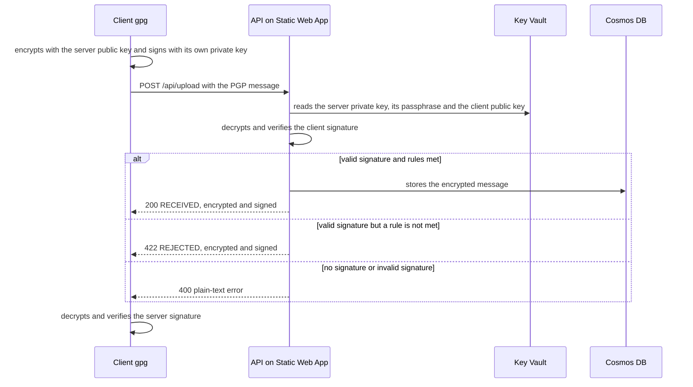

# Secure File Exchange

[Español](README.es.md)

File exchange with PGP encryption and signatures on Azure, built to run at no cost. It is inspired by file exchange in banking environments (SFTP plus PGP): the client drops a file encrypted for the server and signed by the client, and the server replies with a confirmation signed by the server and encrypted for the client.

This is a learning project with test keys, not a system ready for real data. The differences from a real environment are listed under limitations.

## What it does

The client encrypts the file with the server's public key, signs it with its own private key and uploads it over HTTPS. The server can answer in three ways:

- **File accepted (200).** The signature is valid and the file meets the rules. It is stored encrypted and the server returns a `RECEIVED` confirmation with the hash, the size and a receipt ID.
- **File rejected (422).** The signature is valid but the server does not accept the file (empty, or with a disallowed extension). It is not stored, and the server returns a `REJECTED` confirmation with the reason.
- **Unauthenticated sender (400).** No signature, or a signature that is not the client's. The response is a plain-text error. It is deliberately not signed: the transport authenticates nobody, and the server should not sign responses for anyone who calls it.

Both kinds of confirmation are encrypted with the client's public key and signed by the server. The client checks the signature against the server key's fingerprint, which is pinned in the code.



## Why HTTPS and not SFTP

In a real environment the transport would be SFTP. It cannot be run at no cost here: an SSH server needs an always-running process, and Azure has no permanently free virtual machine. So the transport is HTTPS against a serverless API. What this demonstrates is the security part of the flow (encryption, signing, verification and confirmations), not the SFTP protocol itself.

## Architecture

- **Azure Static Web Apps (Free plan).** Serves a static page and hosts the API as managed functions, in Python 3.11. It is deployed from GitHub Actions.
- **Azure Cosmos DB (free tier).** Stores every accepted file as it arrived, encrypted, with the hash, size, date and file name as metadata. Nothing is stored in clear text.
- **Azure Key Vault.** Holds three secrets: the server private key, its passphrase and the client public key.
- **Microsoft Entra ID (App Registration).** The API authenticates to Key Vault with a service principal. Managed Identity is not used because it is not available on the Free plan of Static Web Apps.
- **Terraform.** Defines all the infrastructure. Keys and code are uploaded separately, on purpose: uploading the private key with Terraform would leave it in the state file.

The client uses the `gpg` binary. The server uses PGPy, a pure Python library, because the managed functions have no `gpg` binary.

## Repository layout

```
api/
  upload/          HTTP function POST /api/upload
  shared_code/     pgp_server.py (PGP logic) and rules.py (business rules)
client/            client.py, client_gpg.py and selftest.py
public/            static page and staticwebapp.config.json
infra/             Terraform for the project
policies/          Terraform for the cost policies
guardrails/        Terraform for the budget and the email alert
.github/workflows/ Static Web App deployment
```

## Cost control

The project uses services with a free tier or a negligible usage-based cost. Key Vault, for example, charges per operation, in the order of cents per 10,000, and the API caches secrets while the instance is alive to reduce them. There are two layers to avoid surprises:

- **Subscription-level policies** (`policies/`). They block expensive resource types (virtual machines, SQL, AKS, Application Gateway and similar), limit VMs to `Standard_B1s`, storage to `Standard_LRS`, and restrict the allowed regions.
- **A 1 EUR monthly budget** (`guardrails/`), with an email alert at 50% and 100%.

The budget only alerts, it does not shut anything down, and Azure alerts can take hours. An automatic cut-off function was attempted but never worked and was removed. It also had the Owner role over the whole subscription, a permission that was not worth it. The emergency switch is manual: delete the project resource group.

```
az group delete --name rg-file-exchange
```

## How to deploy

You need an Azure subscription, Azure CLI, Terraform, gpg, Python 3.11 and git. The commands are shown for PowerShell.

1. **Policies and budget**, each in its own folder with its own state:

   ```
   cd policies
   terraform init
   terraform apply
   cd ../guardrails
   terraform init
   terraform apply -var="alert_email=you@example.com"
   ```

2. **Project infrastructure.** Regions are variables (`location` for Cosmos DB and Key Vault, `swa_location` for the Static Web App). On new subscriptions Azure rejects some regions with `locationineligible`. If that happens, change them and add them to the regions policy.

   ```
   cd ../infra
   terraform init
   terraform apply
   ```

3. **Test PGP keys.** Generate two RSA 4096 key pairs with `gpg --full-generate-key`, one for the client and one for the server, each with its own passphrase. The server key preferences have to be adjusted so that gpg does not encrypt with AEAD, which PGPy does not support:

   ```
   gpg --edit-key servidor-demo@proyecto.local
   gpg> setpref S9 S8 S7 H10 H9 H8 Z2 Z3 Z1
   gpg> save
   ```

   Then export them with `--output`, not with PowerShell's `>`, which saves as UTF-16:

   ```
   gpg --yes --armor --output cliente-publica.asc --export cliente-demo@proyecto.local
   gpg --yes --armor --output servidor-privada.asc --export-secret-keys servidor-demo@proyecto.local
   ```

   These files are never committed (`.gitignore` already excludes `.asc` files). The identities above (`cliente-demo@proyecto.local` and `servidor-demo@proyecto.local`) are the ones the client code expects.

4. **Secrets in Key Vault.** The passphrase is read with `Read-Host` so it does not end up in the shell history:

   ```
   az keyvault secret set --vault-name kv-file-exchange --name pgp-server-private-key --file servidor-privada.asc -o none
   az keyvault secret set --vault-name kv-file-exchange --name pgp-client-public-key --file cliente-publica.asc -o none
   $p = Read-Host "Server passphrase"
   az keyvault secret set --vault-name kv-file-exchange --name pgp-server-passphrase --value $p -o none
   ```

5. **Server fingerprint.** In `client/client_gpg.py`, the `SERVER_FPR` constant must be the fingerprint of the server key you just generated (`gpg --fingerprint servidor-demo@proyecto.local`).

6. **Deploying the code.** Save the Static Web App token as a GitHub secret named `AZURE_STATIC_WEB_APPS_API_TOKEN` and push to `main`. The workflow publishes the page and the API.

   ```
   cd infra
   terraform output -raw static_web_app_deployment_token
   ```

## How to test

A local test of the whole cycle, without Azure. It needs `cliente-publica.asc` and `servidor-privada.asc` in a folder:

```
pip install -r client/requirements.txt
python client/selftest.py --keys-dir "path/to/the/keys"
```

Against the deployed API:

```
python client/client.py file.txt --url https://<your-app>.azurestaticapps.net
```

A normal file returns `RECEIVED` with its `receipt_id`. An empty file or one with a disallowed extension (`program.exe`) returns a rejection with `status: REJECTED` and the reason. In both cases the client saves the confirmation as it arrived, encrypted, in `<file>.confirmacion.asc`, and it can be read with `gpg --decrypt`.

## Design decisions and limitations

- **The endpoint is public.** Security is cryptographic: without the client's private key nobody can produce a valid signature. There is no rate limiting and no replay protection, and the same file uploaded twice is stored twice.
- **PGPy does not check key revocation, expiry or flags.** It verifies signatures correctly, but key lifecycle management is out of scope for the library. In a real environment the key management system would cover that.
- **A single client key.** The server knows one client public key. There is no key rotation.
- **Size is limited to 1 MB** of encrypted message, because a Cosmos DB document is limited to 2 MB.
- **500 errors return the error type and message.** This was left in to debug without logs, and it should not be exposed in production.
- **Data residency.** Cosmos DB and Key Vault are in Sweden, but the Static Web App is in East US 2, because the European regions of the service were closed to the subscription. I have not checked where the API runs, and with real data that would have to be reviewed.
- **Terraform state is local.** It contains secrets (Cosmos DB keys, deployment token), which is why `.gitignore` excludes the `.tfstate` files.

## Problems I ran into

- **Regions closed on new subscriptions.** Several services returned `RequestDisallowedByAzure` or `locationineligible`, and every service has its own list of available regions. That is why the Static Web App region is a separate variable.
- **Static Web Apps Free does not support Managed Identity.** Hence the service principal, with read-only permissions on the Key Vault secrets.
- **gpg 2.5 and PGPy do not understand each other by default.** gpg encrypts with AEAD (OCB) when the recipient key advertises it, and PGPy sees an unknown packet. It was solved by adjusting the server key preferences, without touching the code.
- **`cryptography` 48 removes TripleDES from the path PGPy 0.6.0 uses.** `cryptography<48` is pinned in the API requirements.
- **Exporting keys with `>` in PowerShell corrupts them.** It saves as UTF-16 and PGPy cannot read them. With `--output` they come out as ASCII.
- **The deployment token copied with `| clip` arrived with a trailing newline** and Azure rejected it as invalid. With `Set-Clipboard` it worked.
